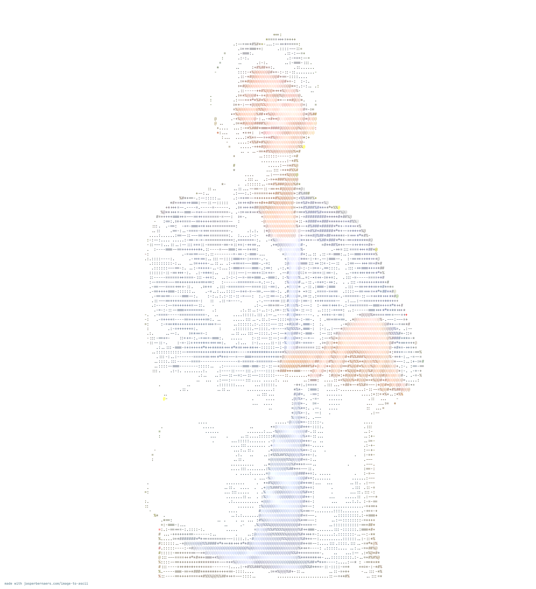

<h3 align="center">🚀 About Me</h3>

**Gathan**, here — an Informatics Engineering student at **Politeknik Negeri Jember** focused on full-stack web, cross-platform mobile, and 2D game development.

I enjoy building scalable web applications, mobile apps, and 2D pixel-art games with custom GLSL shaders under **mie ayam studio**.

Currently, I'm developing **YUDA** (a React Native & Expo mobile app) alongside 2D game projects in **Godot Engine 4.3**, while sharpening my skills in modern web architecture and backend systems.

My goal is simple: write clean code, craft responsive user experiences, and build software that leaves an impact.

 

---

<h3 align="center">🤝 Connect</h3>

  
  &nbsp;&nbsp;
  
  &nbsp;&nbsp;
  

---

<h3 align="center">💻 Tech Stack</h3>

  

  

